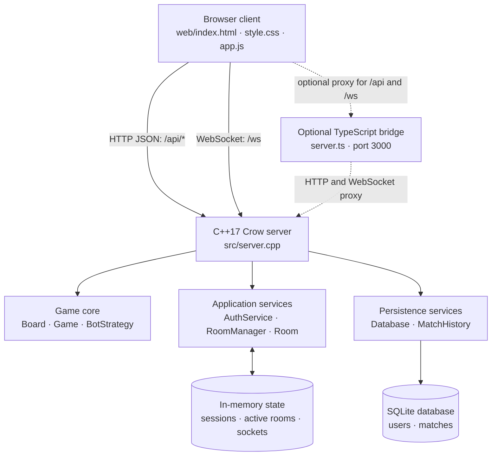
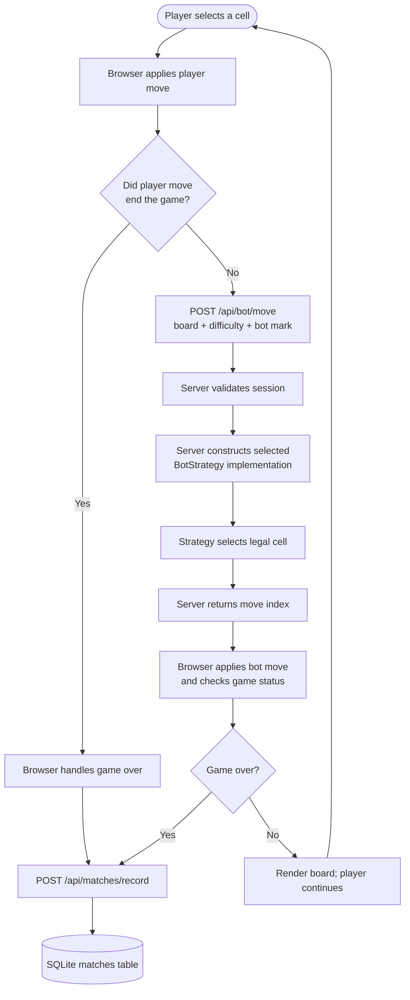
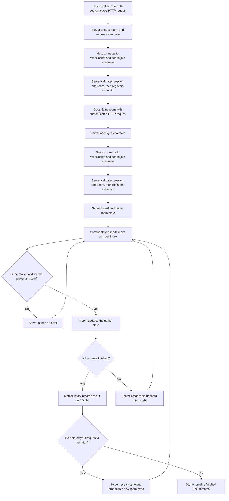
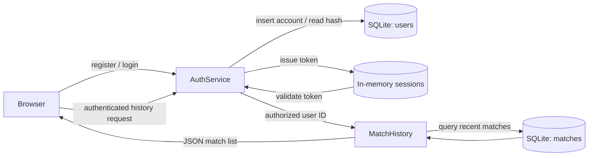
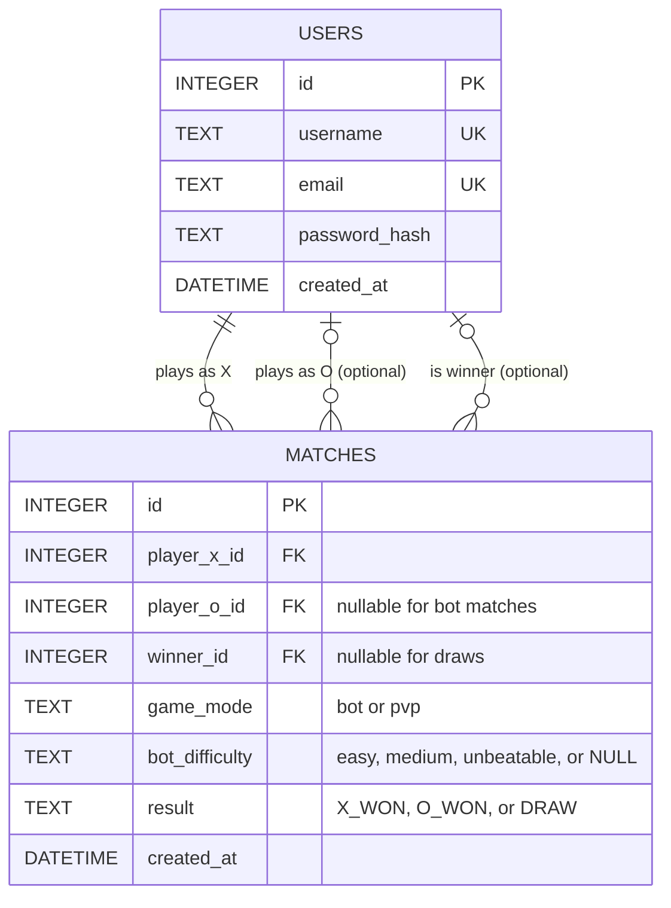

# AFTERLIGHT

AFTERLIGHT is a C++17 Tic-Tac-Toe game and web application built as an object-oriented programming project. It combines a server-authoritative game engine, three bot strategies, account authentication, private online multiplayer, match history, and a browser-based interface.

# Table of Contents

- [Overview](#overview)
- [Key Features](#key-features)
- [System Architecture](#system-architecture)
  - [Multiplayer room and move flow](#multiplayer-room-and-move-flow)
- [Object-Oriented Design & OOP Principles](#object-oriented-design--oop-principles)
- [Database Schema & ER Design](#database-schema--er-design)
  - [Entity-relationship diagram](#entity-relationship-diagram)
- [Project Directory Structure](#project-directory-structure)
- [REST API Reference](#rest-api-reference)
- [Installation & Quick Start](#installation--quick-start)
- [Security & Engineering Practices](#security--engineering-practices)

## Overview

AFTERLIGHT is a browser-based Tic-Tac-Toe game backed by a C++17 server. Users can play against three bot difficulty levels or compete in private multiplayer rooms. Accounts and completed matches are persisted in SQLite.

The C++ server is authoritative: it validates moves and turns, decides bot moves, coordinates multiplayer room state, authenticates users, and records results. The browser client is responsible for presentation and sending HTTP/WebSocket messages; it is not trusted to determine multiplayer outcomes.

## Key Features

### Bot opponents

Choose Easy for a random legal move, Medium for a win/block heuristic, or Unbeatable for a Minimax-based strategy.

### Private multiplayer

An authenticated player creates a room and shares its code. A second authenticated player joins, and the server synchronizes board state and turns over WebSockets.

### Accounts and match history

Users can register, log in, log out, view their profile, and retrieve their recent match records. Password hashes and completed match data are stored in SQLite.

### Browser application and automated tests

The web client provides the game interface. CTest runs the C++ game/bot and server-logic test executables.

## System Architecture

The application is organized as a browser client, a C++ server, a core-logic layer, and a persistence layer. The server exposes two communication styles: request/response HTTP endpoints for discrete operations and a persistent WebSocket connection for live multiplayer updates.



### Browser client

`web/index.html`, `web/style.css`, and `web/app.js` render the interface and communicate with the server. It uses HTTP for account, bot, room setup, and history operations, and a WebSocket for live room play.

### Crow HTTP and WebSocket server

`src/server.cpp` serves the web assets, exposes JSON REST endpoints, authenticates requests, and manages the `/ws` connection protocol. It delegates game and business operations to the C++ core classes.

### C++ core and persistence

The `afterlight_core` CMake library contains game rules, bot algorithms, authentication, match-history access, and room management. `Database` wraps SQLite access; `MatchHistory` stores and retrieves completed games.

### Runtime state and development bridge

SQLite persists users and matches. Sessions, active rooms, and WebSocket connections are held in memory and therefore do not survive a server restart. Optionally, `server.ts` serves the app on port `3000` and proxies API/WebSocket requests to the C++ server on port `5000`.

### Request and response lifecycle

For HTTP operations, the browser sends a JSON request to a Crow route. The route checks authentication when required, invokes the relevant core class or service, and returns a JSON response with the operation result. Multiplayer messages instead remain on the `/ws` connection so the server can broadcast updated room state to connected clients.

### Bot-game flow

The browser manages the bot-mode board presentation and checks the local game result after each move. For a bot turn, it sends the board to the C++ endpoint; the server selects the requested strategy and returns a cell index. When the game ends, the browser submits the result for persistence.



### Multiplayer room and move flow

Room creation and joining begin with authenticated HTTP requests. Each client then connects to `/ws` and sends a `join` message with its token and room code. After joining, the server validates each move against the room's players and game state, records a completed match, and broadcasts updated state.



The room code is created over HTTP and is not itself a WebSocket credential; both players must also provide valid session tokens when joining the socket. The server broadcasts the latest room state after connection and accepted moves. If a move ends the game, the server records the result before broadcasting the updated state.

### Authentication and history flow

Registration stores a password hash and creates an in-memory session. Login loads the stored hash and verifies the supplied password before issuing a session token. Authenticated profile and history requests validate that token; match-history retrieval queries SQLite for the user's most recent records.



## Object-Oriented Design & OOP Principles

This project applies OOP concepts to the game model, bot algorithms, multiplayer rooms, and persistence services.

### Encapsulation

`Board` keeps its nine cells private. Callers must use methods such as `makeMove`, which validates the cell before changing the board. `Player` stores its identity and mark behind getters and setters.

### Abstraction

`BotStrategy` defines the bot contract—`selectMove` and `getDifficulty`—without exposing how a strategy chooses a move. Game and server code can depend on that interface rather than a specific algorithm.

### Inheritance

`EasyBot`, `MediumBot`, and `UnbeatableBot` derive from `BotStrategy`. Each subclass supplies its own move-selection implementation and difficulty label.

### Runtime polymorphism

The server chooses the requested strategy and stores it as a `std::unique_ptr<BotStrategy>`. Calling `selectMove` through this base pointer dispatches to the selected subclass implementation at runtime.

### Composition

`Game` owns a `Board`; a `Room` owns a `Game`, its X player, and an optional O player. These objects form larger game features from collaborating objects rather than using inheritance for unrelated relationships.

```text
RoomManager
  └── manages Rooms
        ├── has a Game
        │     └── has a Board
        ├── has Player X
        └── may have Player O
```

### Single responsibility and service separation

Classes divide responsibilities: `Board` models cells and winning lines; `Game` manages turns and status; `Room` manages one multiplayer game; `RoomManager` manages room lifetimes; `AuthService` handles credentials and sessions; `Database` owns SQLite access; and `MatchHistory` handles match records.

### RAII and resource ownership

`Database` opens its SQLite connection during construction and closes it in its destructor. Smart pointers express ownership for bot strategies and room instances, helping ensure resources are released with their owners.

### Thread safety

The multithreaded Crow server shares state across requests. Mutexes protect shared database operations, authentication sessions, room management, and WebSocket connection tracking from unsynchronized concurrent access.

### Main class relationships

```text
BotStrategy (abstract)
  ├── EasyBot
  ├── MediumBot
  └── UnbeatableBot

RoomManager ── manages ──> Room ── owns ──> Game ── owns ──> Board
                                  └── contains Player X and optional Player O

AuthService ── uses ──> Database <── uses ── MatchHistory
```

## Database Schema & ER Design

The schema in [`database/schema.sql`](database/schema.sql) defines two persistent entities: users and completed matches. SQLite foreign-key enforcement is enabled by the application.

### Entity-relationship diagram



### `users` entity

Each user has an integer primary key, a case-insensitively unique username and email, an Argon2id password hash, and a creation timestamp. The username and email columns have indexes to support lookup.

### `matches` entity

Each match stores its mode (`bot` or `pvp`), result (`X_WON`, `O_WON`, or `DRAW`), optional bot difficulty, and creation timestamp. `player_x_id` is required; `player_o_id` is nullable for bot games; and `winner_id` is nullable for draws. Foreign keys reference `users.id`. Deleting a user cascades to matches where they are X or O, while deleting a referenced winner sets `winner_id` to `NULL`.

### Relationships and constraints

One user can be associated with many matches in each participant/winner role. `CHECK` constraints restrict allowed modes, bot difficulties, and results. Indexes exist on both account lookup columns and the match player foreign keys.

## Project Directory Structure

```text
AfterLight3/
├── database/
│   └── schema.sql             SQLite tables, constraints, and indexes
├── docs/
│   └── README.md              Additional project documentation
├── include/                   C++ class and service declarations
├── src/                       C++ implementations and Crow server
├── tests/                     Game/bot and server-logic tests
├── third_party/crow/          Crow HTTP and WebSocket framework
├── web/
│   ├── app.js                 Browser interactions and API communication
│   ├── index.html             Application page
│   └── style.css              Application styles
├── CMakeLists.txt             C++ build targets and CTest configuration
├── package.json               Optional TypeScript bridge scripts/dependencies
├── server.ts                  Optional frontend/API development bridge
└── README.md
```

Important C++ headers in `include/` correspond to implementations in `src/`. `afterlight.db` is the SQLite database file created or used at runtime; `build/` contains generated build files and executables.

## REST API Reference

The Crow server exposes JSON endpoints under `/api`; requests and responses use JSON unless noted otherwise. Successful registration and login return a session token. For authenticated HTTP requests, include the issued session token in the `Authorization` header. The server also accepts a `token` query parameter, but the header is preferable because it avoids placing credentials in URLs.

### Authentication endpoints

| Method | Endpoint | Purpose | Authentication |
|---|---|---|---|
| `POST` | `/api/auth/register` | Register using `username`, `email`, and `password`; returns a user and session token. | No |
| `POST` | `/api/auth/login` | Log in using `username` or `email` and `password`; returns a user and session token. | No |
| `POST` | `/api/auth/logout` | Invalidate the supplied session token. | Token accepted |
| `GET` | `/api/auth/me` | Return the authenticated user's profile. | Yes |

### Bot endpoint

| Method | Endpoint | Purpose | Authentication |
|---|---|---|---|
| `POST` | `/api/bot/move` | Select a bot move for a supplied board. | Yes |

### Multiplayer room endpoints

| Method | Endpoint | Purpose | Authentication |
|---|---|---|---|
| `POST` | `/api/rooms/create` | Create a private room; returns its code. | Yes |
| `POST` | `/api/rooms/join` | Join a room using `roomCode`. | Yes |

### Match history endpoints

| Method | Endpoint | Purpose | Authentication |
|---|---|---|---|
| `POST` | `/api/matches/record` | Record a match result. | Yes |
| `GET` | `/api/matches/history` | Retrieve up to 30 match records for the user. | Yes |

### Request examples

Register:

```json
{
  "username": "player1",
  "email": "player@example.com",
  "password": "your-password"
}
```

For login, send `username` or `email` and `password`.

Request a bot move:

```json
{
  "difficulty": "medium",
  "board": "X O   X  ",
  "botMark": "O"
}
```

The board is a nine-character string; spaces represent empty cells. Supported difficulty values are `easy`, `medium`, and `unbeatable`.

Join a room:

```json
{ "roomCode": "ABC123" }
```

Room creation does not require a request body. Match recording accepts `gameMode` as `bot` or `pvp`, `result` as `X_WON`, `O_WON`, or `DRAW`, and an optional `botDifficulty` (`easy`, `medium`, or `unbeatable`). For PvP records, `playerOId` may be supplied.

### WebSocket protocol (`/ws`)

Connect to `/ws`, then join a room by sending a JSON message with the session token and room code:

```json
{ "type": "join", "token": "<session-token>", "roomCode": "ABC123" }
```

Send a move using a zero-based cell index from `0` to `8`, or request a rematch:

```json
{ "type": "move", "cell": 0 }
{ "type": "rematch" }
```

The server broadcasts `room_state` messages containing the room code, players, board, current turn, game status, winning line, and move count. These may include events such as `client_sync`, `player_joined`, `move_made`, `rematch_requested`, `rematch_started`, or `player_disconnected`. Rejected actions are sent as `error` messages.

## Installation & Quick Start

### Prerequisites

Install a C++17 compiler, CMake, SQLite development headers, Argon2 development headers, and Asio. On Ubuntu/Debian:

```bash
sudo apt-get update
sudo apt-get install -y build-essential cmake libsqlite3-dev libargon2-dev libasio-dev
```

### Build, test, and run

From the project directory:

```bash
cmake -B build -DCMAKE_BUILD_TYPE=Release
cmake --build build -j4
ctest --test-dir build --output-on-failure
./build/afterlight_server 3000
```

Open [http://localhost:3000](http://localhost:3000). The server accepts an optional port argument (defaults to `3000`) and serves the frontend and API on that port. Start it from the project directory so it can find `web/` and `database/schema.sql`; the SQLite database is opened as `afterlight.db` in the current working directory.

To use the optional TypeScript development bridge, install the Node.js dependencies with `npm install` after building the C++ server, then run:

```bash
npm run dev
```

The bridge serves the web application on port `3000` and starts/proxies to the C++ server on port `5000`.

## Security & Engineering Practices

### Password handling

Passwords are stored as salted Argon2id hashes rather than plaintext. Registration validates basic username, email, and minimum-password-length requirements.

### Database safety and integrity

Account and match queries use SQLite prepared statements. Case-insensitive uniqueness constraints protect usernames and emails, while foreign keys and `CHECK` constraints enforce valid relationships and match values.

### Authentication and authorization

Protected HTTP routes validate session tokens on the server. WebSocket room actions are associated with an authenticated user, and the server checks that user's identity before accepting gameplay actions.

### Multiplayer validation

The server checks participant identity, turn order, cell availability, and game status before accepting a move. The browser client is not the authority for game outcomes.

### Concurrency and testing

Mutexes protect shared database, session, room, and WebSocket state. CMake configures C++17 and compiler warnings for GNU/Clang; CTest runs the registered game and server-logic tests.

### Deployment considerations

Sessions and active rooms are in memory, so a backend restart invalidates sessions and clears rooms. Before exposing the application publicly, use HTTPS/WSS and review token generation, request validation, operational logging, and production configuration for the intended threat model.
