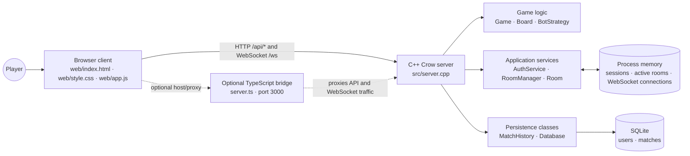
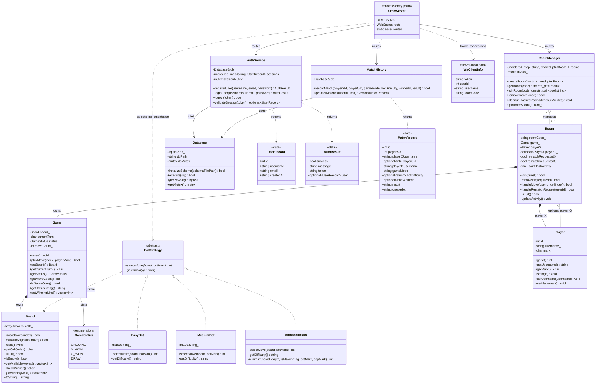

# AFTERLIGHT UML

This document focuses on the system context and the main C++ class relationships.

## System context

The browser is the user-facing client. It communicates with the C++ Crow server using HTTP for account, bot, room setup, and history operations, and WebSockets for live multiplayer. The optional TypeScript bridge serves the browser assets and proxies requests to Crow. The server delegates game and service logic to `afterlight_core`; SQLite persists user and match data, while sessions, active rooms, and socket connections remain in memory.

## Class diagram

## Class details

| Class | Details |
|---|---|
| `CrowServer` | The process entry point implemented in `src/server.cpp`, rather than a standalone domain class. Defines the HTTP, WebSocket, and static-file routes and connects incoming requests to the core services. |
| `Board` | Encapsulates the nine cells and board operations. Validates moves, provides legal cells, and detects wins, winning lines, and draws. |
| `Game` | Owns a `Board` and controls turns, move validity, and the outcome represented by `GameStatus`. |
| `GameStatus` | Enumeration of the four game states: ongoing, an X win, an O win, or a draw. |
| `BotStrategy` | Abstract interface for selecting a move and reporting a difficulty. The server can use any concrete strategy through this common interface. |
| `EasyBot` | Implements the easy level by selecting a random legal move. |
| `MediumBot` | Implements the medium level using a win/block heuristic with limited lookahead. |
| `UnbeatableBot` | Implements the unbeatable level using Minimax to evaluate possible moves. |
| `Player` | Holds a participant's user ID, username, and X/O mark. Used for human players in multiplayer rooms. |
| `Room` | Owns a `Game` and the host player, and optionally holds a second player. Validates room moves and coordinates rematches and activity tracking. |
| `RoomManager` | Thread-safe in-memory registry that creates, looks up, joins, and removes active rooms, and cleans up inactive ones. |
| `Database` | Owns the SQLite connection and its mutex. Initializes the schema and provides synchronized access used by persistence services. |
| `AuthService` | Registers and authenticates users, verifies password hashes, and manages process-local session tokens. Uses `Database` for persisted account data. |
| `UserRecord` | Data structure for a user's ID, username, email, and account creation time; returned by authentication operations. |
| `AuthResult` | Carries an authentication operation's success status, message, session token, and optional `UserRecord`. |
| `MatchHistory` | Records completed matches and retrieves a user's history through the shared `Database` instance. |
| `MatchRecord` | Data structure describing a stored match, including participants, mode, optional bot difficulty and winner, result, and timestamp. |
| `WsClientInfo` | Server-local data associated with a WebSocket connection: session token, user identity, and joined room code. It is not a persisted database record. |

The `*--` relationships indicate composition: `Game` owns its `Board`, and `Room` owns its `Game` and host player. `RoomManager` keeps shared references to active rooms. Bot implementations inherit from `BotStrategy` and are selected at runtime by the server.
