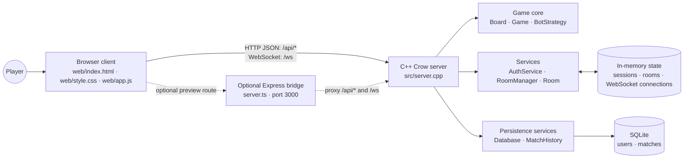
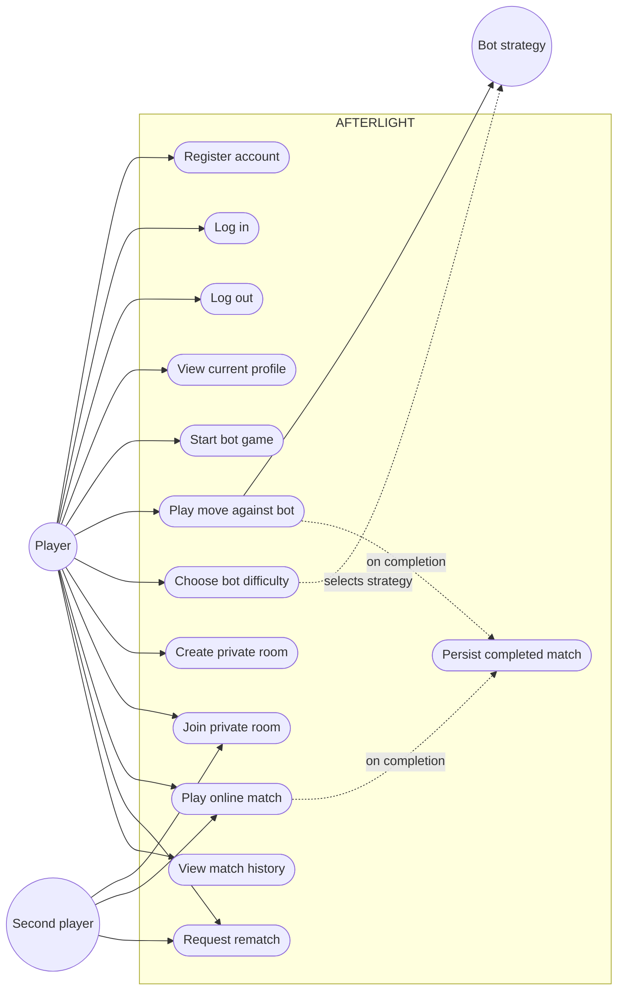
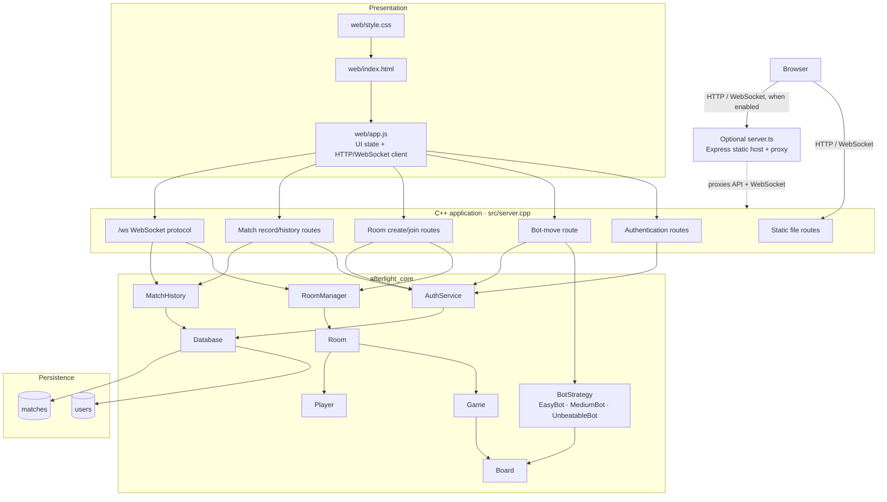
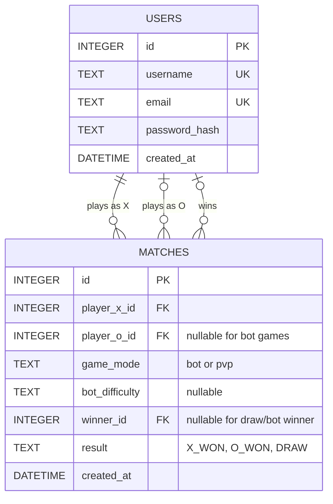
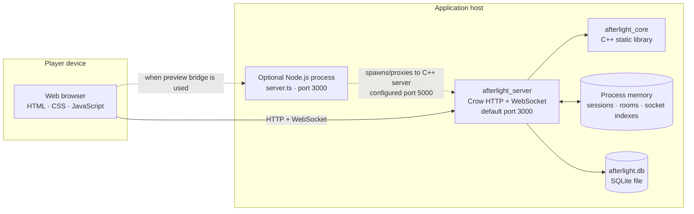

# AFTERLIGHT UML

This document describes the architecture implemented in this repository: the browser client, the authoritative C++/Crow server, its game and service classes, in-memory multiplayer state, and SQLite persistence. Diagrams use Mermaid and can be rendered by GitHub and compatible Markdown viewers.

## 1. System context

The browser communicates directly with the C++ server by default. The optional TypeScript/Express bridge serves the browser assets and proxies `/api/*` and `/ws` traffic to the C++ server.



### Main responsibilities

| Area | Responsibilities |
|---|---|
| Browser | Renders login, lobby, arena, and history views; sends HTTP requests and WebSocket messages; presents server room state. Bot-mode board presentation and result checking also happen in the browser. |
| Crow server | Serves the browser files, handles REST endpoints and `/ws`, validates sessions, selects bot strategies, coordinates rooms, and records completed matches. |
| Game core | Encapsulates board rules and turn/status transitions; provides interchangeable bot strategies. |
| Services | `AuthService` manages credentials and process-local sessions; `RoomManager` owns the active room registry; each `Room` coordinates two players and one game. |
| Persistence | `Database` owns the SQLite connection; `AuthService` and `MatchHistory` use it. SQLite persists users and completed matches. |
| Express bridge | Optional development/preview server that serves `web/` and proxies API and WebSocket traffic. It does not own application or game logic. |

## 2. Use-case diagram



Registration and login create process-local session tokens. Bot moves are requested from the server through `/api/bot/move`; the browser manages the bot-mode board and submits the completed result through `/api/matches/record`. Online room moves are validated by the server, which records a finished match itself.

## 3. Component diagram



`src/server.cpp` constructs one `Database`, `AuthService`, `MatchHistory`, and `RoomManager` for the server process. WebSocket connection tracking and the room-to-connection index are additional server-local state, not persistent entities.

## 4. Class diagram


The `*--` links indicate owned/composed objects. `Room` contains its game and host player, and may contain a second player. `RoomManager` holds shared pointers to active rooms. Bot subclasses implement the `BotStrategy` interface; the bot endpoint selects one at runtime and calls it polymorphically.

## 5. Entity-relationship diagram



`player_x_id` is required. `player_o_id` is nullable for a bot match, and `winner_id` is nullable for draws and bot wins. Deleting a participant cascades through their X/O match references; deleting a winner sets `winner_id` to `NULL`. Sessions and active rooms are not stored in these tables.

## 6. Sequence diagrams

### 6.1 Registration and login

```mermaid
sequenceDiagram
    actor Player
    participant UI as Browser app.js
    participant API as Crow auth route
    participant Auth as AuthService
    participant DB as Database / SQLite

    Player->>UI: Submit registration or login form
    UI->>API: POST /api/auth/register or /api/auth/login
    API->>Auth: registerUser(...) or loginUser(...)
    alt Registration
        Auth->>DB: Check username/email; insert password hash
        DB-->>Auth: User id / insert result
        Auth->>Auth: Create process-local session token
    else Login
        Auth->>DB: Find user and stored password hash
        DB-->>Auth: User record + password hash
        Auth->>Auth: Verify password; create session token
    end
    Auth-->>API: AuthResult
    API-->>UI: JSON success, user, and token
    UI->>UI: Store token in localStorage; show lobby
```

Session tokens are stored in the `AuthService` process memory; they are not persisted to SQLite. Authenticated requests send the token as a Bearer authorization header.

### 6.2 Bot match and match recording

```mermaid
sequenceDiagram
    actor Player
    participant UI as Browser app.js
    participant API as Crow server
    participant Auth as AuthService
    participant Bot as BotStrategy implementation
    participant History as MatchHistory
    participant DB as SQLite

    Player->>UI: Select a cell
    UI->>UI: Apply player move and check local board status
    alt Player move ends the game
        UI->>UI: Display result
        UI->>API: POST /api/matches/record
        API->>Auth: validateSession(token)
        API->>History: recordMatch(..., gameMode=bot)
        History->>DB: INSERT matches row
    else Game continues
        UI->>API: POST /api/bot/move(board, difficulty, botMark)
        API->>Auth: validateSession(token)
        API->>Bot: selectMove(board, botMark)
        Bot-->>API: Cell index
        API-->>UI: JSON move + difficulty
        UI->>UI: Apply bot move; check status and render
        opt Game is finished
            UI->>API: POST /api/matches/record
            API->>Auth: validateSession(token)
            API->>History: recordMatch(..., gameMode=bot)
            History->>DB: INSERT matches row
        end
    end
```

`EasyBot`, `MediumBot`, and `UnbeatableBot` select a move from a `Board`. In bot mode the browser applies moves and checks the result; `/api/bot/move` returns a selected move, while result persistence is separately requested by the browser.

### 6.3 Private multiplayer match

```mermaid
sequenceDiagram
    actor Host
    actor Guest
    participant UI as Browser app.js
    participant API as Crow HTTP / WebSocket
    participant Auth as AuthService
    participant Manager as RoomManager
    participant Room as Room + Game
    participant History as MatchHistory
    participant DB as SQLite

    Host->>UI: Create private room
    UI->>API: POST /api/rooms/create + token
    API->>Auth: validateSession(token)
    API->>Manager: createRoom(host Player)
    Manager->>Room: Construct room with host as X
    API-->>UI: roomCode
    UI->>API: Open /ws; send join(token, roomCode)
    API->>Auth: validateSession(token)
    API->>Manager: getRoom(roomCode)
    API-->>UI: room_state (initial)

    Guest->>UI: Enter room code and join
    UI->>API: POST /api/rooms/join + token + roomCode
    API->>Auth: validateSession(token)
    API->>Manager: joinRoom(roomCode, guest Player)
    Manager->>Room: join(guest as O)
    API-->>UI: Join succeeded
    UI->>API: Open /ws; send join(token, roomCode)
    API->>Auth: validateSession(token)
    API->>Manager: getRoom(roomCode)
    API-->>UI: Broadcast room_state to room clients

    loop Each turn
        Host->>API: WebSocket move(cell)
        API->>Manager: getRoom(roomCode)
        API->>Room: handleMove(userId, cell)
        Room->>Room: Validate membership, turn, and cell; update Game
        API-->>UI: Broadcast updated room_state
    end

    opt Game ends
        API->>History: recordMatch(players, pvp, result)
        History->>DB: INSERT matches row
        API-->>UI: Broadcast final room_state
    end
    opt Both players request rematch
        Host->>API: WebSocket rematch
        Guest->>API: WebSocket rematch
        API->>Room: handleRematchRequest(userId)
        Room->>Room: Reset Game after both requests
        API-->>UI: Broadcast rematch_started and fresh room_state
    end
```

The diagram abbreviates the repeating turn as a Host request; either connected participant may send the move, but `Room::handleMove` accepts it only from the player whose mark matches the current turn.

## 7. Game state diagram

```mermaid
stateDiagram-v2
    [*] --> ONGOING: Game construction / reset
    ONGOING --> ONGOING: valid move; no win and board not full
    ONGOING --> X_WON: valid move completes X line
    ONGOING --> O_WON: valid move completes O line
    ONGOING --> DRAW: valid move fills board without a winner
    X_WON --> ONGOING: reset()
    O_WON --> ONGOING: reset()
    DRAW --> ONGOING: reset()
```



Invalid moves do not change game state. `Game::playMove` checks that the game is ongoing and the mark matches `currentTurn_`, delegates cell validation to `Board`, and updates the result or switches turns.

## 8. Deployment diagram



When `server.ts` is used, it listens on port `3000`, launches the C++ backend on port `5000`, serves the frontend, and proxies `/api/*` and `/ws`. The C++ server defaults to port `3000` when launched directly, but accepts a port argument. The SQLite database is a local file; sessions, active rooms, and WebSocket connection maps are process-local and are lost on restart.

## 9. Relationship summary

| Source | Relationship | Target | Meaning |
|---|---|---|---|
| `Game` | Composition | `Board` | A game owns its board and delegates cell state/rules to it. |
| `Room` | Composition | `Game`, `Player` | A room owns one game and its host; a guest player is optional. |
| `RoomManager` | Aggregation/registry | `Room` | Stores shared pointers to active rooms indexed by room code. |
| `EasyBot`, `MediumBot`, `UnbeatableBot` | Inheritance | `BotStrategy` | Concrete move algorithms fulfill the same runtime-polymorphic interface. |
| `BotStrategy` | Dependency | `Board` | Receives board state to choose a legal move. |
| `AuthService` | Association | `Database` | Reads/writes account records; keeps active sessions in memory. |
| `MatchHistory` | Association | `Database` | Stores and queries completed matches. |
| `MATCHES` | Foreign keys | `USERS` | Identifies X player, optional O player, and optional winner. |
| Crow routes | Dependency | Core/services | HTTP and WebSocket handlers invoke domain logic and persistence. |
| Browser | Client relationship | Crow server | Sends API requests and receives authoritative multiplayer room snapshots. |
| Express bridge | Proxy relationship | Crow server | Optional static host/proxy; it does not replace backend responsibilities. |
